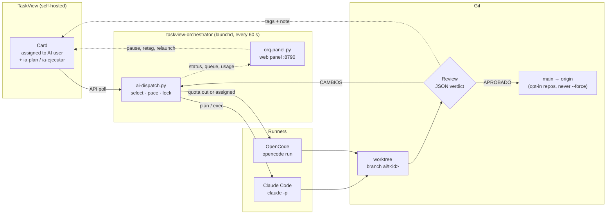

<div align="center">

# taskview-orchestrator

**Turn a self-hosted TaskView board into a queue of work for AI coding agents.**

Assign a card to Claude Code or OpenCode, add one tag, and the orchestrator plans or implements it in its own git
worktree, reviews the result, and lands it on `main` where you allow it.

[](https://www.python.org/)
[](#requirements)
[-000000?logo=apple&logoColor=white)](#launchagents)
[](https://docs.anthropic.com/en/docs/claude-code)
[](https://opencode.ai)
[](LICENSE)

[What it is](#what-it-is) · [Architecture](#architecture) · [Features](#features) · [Install](#installation) ·
[Configure](#configuration) · [LaunchAgents](#launchagents) · [Tests](#tests) · [Español](#en-español)

</div>

---

## What it is

`taskview-orchestrator` is a set of small Python and shell scripts that sit next to a self-hosted
[TaskView](https://github.com/Gimanh/taskview-community) instance and talk to it only through its HTTP API. It is not a fork of
TaskView and contains no TaskView code.

Every minute a dispatcher looks for cards that are **assigned to an AI user** and carry a **mode tag**:

| Tag | What happens |
|---|---|
| `ia·plan` | Read-only session. Writes a plan into the card note and moves it to Review. |
| `ia·ejecutar` | Implements the card on branch `ai/t<id>` in its own worktree, then an automatic review approves it or asks for changes. |
| `ia·continuar` | Resumes a session that stopped with a question, after you write `RESPUESTA: …` in the note. |
| `ia·correo` | Emails the result when the run ends. |

The outcome is always visible on the card: `ia·trabajando` while running, then `ia·plan-listo`, `ia·hecho`,
`ia·cambios`, `ia·pregunta` or `ia·fallo`. Cards assigned to you, or tagged `para-mí`, are never touched.

The UI labels and tags are in Spanish because that is the language of the board it was built for; the code and
comments are in English.

## Architecture



| Schedule | Script | Role |
|---|---|---|
| every 60 s | `ai-dispatch.py` | picks a card, runs the session, reviews, integrates |
| always on | `orq-panel.py` + `orq-panel.html` | local web panel on `127.0.0.1:8790` |
| every 15 min | `ai-supervisor.sh` | optional Claude session that re-queues stalled cards of chosen boards |
| every 60 s | `claude-interactive-handoff.py` | hands interactive Claude sessions to OpenCode when the 5 h window runs out |
| 08:00 | `sync.py` | GitHub issues and PRs become cards |
| 08:05 | `daily.py` | morning digest to the phone and by mail |
| Sun 19:00 | `weekly.py` | weekly review by mail |
| hourly | `healthcheck.py` | TaskView API, backups, optional production site |
| 03:30 | `backup.sh` | daily `pg_dump`, 14 kept; `restore-test.sh` verifies them |

## Features

- **Assignee decides who, tag decides what.** Claude, OpenCode or both; a card assigned to both runs on the runner you
  choose in the panel.
- **Isolated work.** Each card gets `<code_root>/.ai-worktrees/<repo>-t<id>` on branch `ai/t<id>`. Sessions run with an
  allow list and a deny list (`git push`, `rm`, `curl`, `sudo`, `git reset`, merges and rebases are denied), extended
  per repo when a project needs Docker or full Bash.
- **Plan, execute, review.** Model per mode (`MODELS` in `ai-dispatch.py`), subagents for code search and tests, and a
  review that answers with a JSON schema verdict. Up to `max_rounds` execute and review rounds.
- **Questions instead of guesses.** A session that lacks information ends with `PREGUNTA: …`; you answer in the note
  and the same session resumes.
- **Usage pacing.** Reads Claude's 5 h and weekly usage and keeps the dispatcher under a straight line, with hard caps,
  phone alerts and time windows reserved for specific boards.
- **Fallback chain.** Claude paced or limited, then OpenCode, then a reserve model, then (never on sensitive boards) a
  free model. One alert when it degrades, one when it recovers.
- **Opt-in merge to main.** For repos you list, approved branches are merged into `main`, tested and pushed. Never
  `--force`; conflicts become a question on the card.
- **Panel.** Status, queue, questions, recent runs with cost and duration, usage, editable settings, per-card actions
  and a manual pause. Listens on localhost only, plus an optional Tailscale Serve host.
- **Housekeeping.** GitHub sync, daily and weekly digests, health checks, verified database backups, worktree cleanup.

## Requirements

- macOS (scheduling uses launchd; the scripts themselves are plain Python)
- `/usr/bin/python3`, standard library only
- A self-hosted TaskView API on `http://127.0.0.1:1725`
- `claude` and/or `opencode` on the `PATH`
- Docker for backups and the restore test; `gh` for `sync.py`; a `send-mail` command if you want mail

## Installation

```sh
git clone https://github.com/juansuarezdev/taskview-orchestrator.git
cd taskview-orchestrator

# Credentials stay local (gitignored)
cp examples/credentials.example .credentials && chmod 600 .credentials   # login, password, email
cp examples/api-token.example .api-token && chmod 600 .api-token         # scoped API token (preferred)

# Site settings: boards, repos, mail, hosts
cp examples/orq-site.example.json orq-site.json
$EDITOR orq-site.json

# Optional
cp examples/orq-config.example.json orq-config.json        # or edit it from the panel
cp examples/web-tasks.example.txt web-tasks.txt            # task ids allowed to use the web during exec
cp examples/reserva-claude.example.json .reserva-claude.json
cp examples/opencode-fallback-exclude.example .opencode-fallback-exclude
cp examples/ai-supervisor-prompt.example.md ai-supervisor-prompt.md   # only if you use the supervisor
```

Create two TaskView users for the runners (`claude@taskview.local` and `opencode@taskview.local` by default, see
`ia-users.json`) and add them as collaborators on the boards you want served.

## Configuration

There are two files, both gitignored, both optional:

**`orq-site.json`** describes your machine. Nothing personal is hard-coded; every key defaults to empty.

| Key | Purpose | Env override |
|---|---|---|
| `repos` | TaskView board name to repo folder | |
| `code_root` | folder with one checkout per repo | `ORQ_CODE_ROOT` |
| `extra_roots` | repos that live elsewhere (`"."` = `code_root` itself) | |
| `mail_to` | recipient for `ia·correo` and digests (empty = no mail) | `ORQ_MAIL_TO` |
| `main_test_cmd`, `laravel_docker_test`, `test_env_repos` | how to test a repo before pushing `main` | |
| `repo_extra_bash`, `repo_bash_all`, `repo_extra_denied` | per-repo permission scopes | |
| `sensitive_boards` | boards that never use free models | |
| `github_owner`, `github_repo_boards` | what `sync.py` imports | `ORQ_GITHUB_OWNER` |
| `tailnet_host`, `tailnet_port` | extra host the panel accepts | `ORQ_TS_HOST` |
| `health_host` | production site for `healthcheck.py` | `ORQ_HEALTH_HOST` |
| `launchd_prefix` | LaunchAgent label prefix | `ORQ_LABEL_PREFIX` |
| `event_log_cmd` | command that receives start and end events | `ORQ_EVENT_LOG_CMD` |

**`orq-config.json`** holds dispatcher behaviour and is what the panel edits
([`examples/orq-config.example.json`](examples/orq-config.example.json)): tick interval, runner choice, pacing limits,
usage alerts, review rounds, budget per session, `merge_to_main_repos`, disabled boards and priorities. Only keys that
differ from the defaults are written, and a bad value falls back to its default.

Per card, lines in the note can override `MODEL:`, `BUDGET_USD:`, `TIMEOUT_MIN:` and `WORKTREE_BASE:`.

## LaunchAgents

Templates live in [`launchd/`](launchd) with three placeholders: `__ORQ_DIR__`, `__HOME__` and `__LABEL_PREFIX__`.

```sh
ORQ_DIR="$PWD"; PREFIX="com.example"     # same value as launchd_prefix in orq-site.json
for f in launchd/*.plist.example; do
  name="$PREFIX.$(basename "$f" .plist.example).plist"
  sed -e "s#__ORQ_DIR__#$ORQ_DIR#g" -e "s#__HOME__#$HOME#g" -e "s#__LABEL_PREFIX__#$PREFIX#g" \
      "$f" > ~/Library/LaunchAgents/"$name"
  launchctl bootstrap gui/$(id -u) ~/Library/LaunchAgents/"$name"
done
```

Load only the agents you need. To stop one: `launchctl bootout gui/$(id -u)/$PREFIX.taskview-ai`.
To pause everything without unloading: `python3 orq-panel.py --pause` (and `--resume`).

Useful commands:

```sh
python3 ai-dispatch.py --dry-run        # what would run now, changes nothing
python3 ai-dispatch.py --usage          # Claude usage and pacing decision
python3 ai-clean.py                     # worktrees whose card is done
bin/estado-orquestador                  # read-only status in the terminal
```

## Tests

```sh
for t in tests/test_*.py; do python3 "$t" || exit 1; done
# or
python3 -m unittest discover -s tests
```

Tests point `ORQ_CONFIG_FILE` and `ORQ_SITE_FILE` at temporary files, use fake APIs, and never touch your real
settings, TaskView or git repos.

## Project layout

| Path | Role |
|---|---|
| `ai-dispatch.py` | dispatcher |
| `orq_site.py`, `orq_config.py` | site settings and panel-editable settings |
| `ia_users.py`, `ia-users.json`, `ia-packs.json` | owner and AI users; "pack" tags that combine mode and mail |
| `orq-panel.py`, `orq-panel.html` | web panel |
| `phonebox-widget.html`, `phonebox-orq-install.py` | optional home-screen card for a PhoneBox dashboard |
| `ai-supervisor.sh`, `ai-supervisor-schema.json` | optional supervisor session |
| `notify.py`, `mac-notifier/` | Web Push through TaskView plus a native macOS banner |
| `sync.py`, `daily.py`, `weekly.py`, `healthcheck.py`, `backup.sh`, `restore-test.sh` | housekeeping |
| `.opencode-*` | OpenCode model ids: primary, reserve, private reserve, free |
| `examples/` | templates for every local file that is not versioned |

## License

[MIT](LICENSE). TaskView itself is distributed by its authors under its own source-available license; this project only
calls its API and does not include or modify TaskView code. "TaskView" is used here only to name the software it works
with.

---

## En español

`taskview-orchestrator` convierte un tablero de TaskView self-hosted en una cola de trabajo para agentes de IA. Asignas
una tarjeta a Claude Code u OpenCode, le pones `ia·plan` o `ia·ejecutar`, y el despachador (cada 60 s, vía launchd)
la planifica o la implementa en su propia rama `ai/t<id>`, la revisa y, en los repos que tú elijas, la integra en
`main` sin `--force` jamás. Si a la sesión le falta información, deja una `PREGUNTA:` en la tarjeta y continúa cuando
respondes con `RESPUESTA:` y `ia·continuar`.

Para instalarlo: copia las plantillas de `examples/` (credenciales, `orq-site.json` con tus tableros y repos, y
opcionalmente `orq-config.json`), carga los LaunchAgents de `launchd/` con tu prefijo y abre el panel en
`http://127.0.0.1:8790`. Ningún dato personal va en el código: todo lo específico de tu máquina vive en ficheros
locales ignorados por git o en variables de entorno `ORQ_*`.
